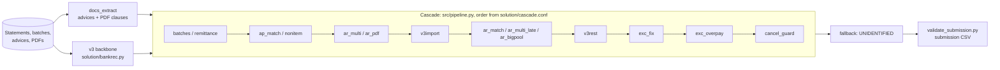

# Close the Books: bank reconciliation at scale

Team entry for the **Talky x Anthropic "Close the Books" hackathon** (7 Nov 2026). The task: take a half-year of
bank statements from a synthetic industrial group (17 entities, 12 currencies, 13 banks, ~220k bank movements) and say,
for every movement, **which open invoices / credit notes it settles and for how much**, or **what it is** when it settles
none (fee, payroll, cash-pool sweep, tax...), flagging exceptions such as partial payments, discounts, withholding, FX
differences, returns and duplicates.

Final result: **94.24 on the hidden FINAL phase** (as shown by the platform). The honest details, including what went
wrong, are below and in [`notes/FINAL_SUBMISSION.md`](notes/FINAL_SUBMISSION.md).

> **Important:** the file we uploaded was produced by a later teammate branch (`model/v8b-pf`, commit `700bf5f` of the
> team repo, see [Credits](#credits)). That code is **not** in this repository. This repo contains the shared
> cascade up to the v6c line plus my own additions (`exc_overpay`, run-time guards) and all the evaluation and
> anti-overfitting tooling. It is the architecture and the method, not a bit-exact copy of the submitted pipeline.

## The problem

- Bank lines arrive in three statement formats (Norma 43, camt.053, MT940) plus SEPA direct-debit batches, card
  settlements, cheque deposits, payment runs, remittance advices (CSV/XLSX/e-mail/PDF) and PDF documents.
- Invoice numbers are rarely verbatim in the bank text; the (truncated) payer name is the main key.
- One receipt can pay 300 invoices with an advice that arrives days later; one SEPA batch is a single bank line.
- Key context lives in PDFs ("instalment 2 of 3", "5 % retention", "cancels and replaces...").
- Some receipts have no invoice at all and must be flagged `UNIDENTIFIED` rather than forced.
- Drift is deliberate: a bank migrates formats, a customer changes its remittance layout, a subsidiary is acquired
  in FINAL (South Africa, ZAR), customers are renamed or pay late.

## Scoring

`score = 100 x (0.5 x allocation F1 + 0.3 x transaction accuracy + 0.2 x exception macro-F1)`

- *Allocation F1*: over (bank line, item) pairs with the allocated amount.
- *Transaction accuracy*: share of bank lines answered exactly right.
- *Exception macro-F1*: over the 10 exception classes (`PARTIAL`, `OVERPAYMENT`, `SHORT_DISCOUNT`,
  `SHORT_BANK_CHARGES`, `SHORT_WITHHOLDING`, `SHORT_DISPUTE`, `DUPLICATE_PAYMENT`, `UNIDENTIFIED`, `RETURNED`,
  `FX_DIFFERENCE`). Because it is a macro average, a few rows of a rare class move the score a lot.

## Architecture: a cascade of passes

A precise but narrow **v3 backbone** (`solution/bankrec.py`) answers first. A **cascade of specialised passes**
(`src/passes/`) then runs over one shared ledger of open items. Each bank line is claimed by the first pass that has
strong evidence; later passes only see what is left. Whatever nobody explains becomes `UNIDENTIFIED`.



| Pass | Job |
|---|---|
| `batches` | SEPA direct-debit batches, card settlements, cheque deposits, payment runs, returns |
| `remittance` | allocations read from remittance advices (CSV / XLSX / e-mail / PDF) |
| `ap_match`, `nonitem` | supplier payments; lines that settle no item (fees, payroll, tax, cash pool...) |
| `ar_multi`, `ar_pdf` | receipts paying several invoices; clauses read from PDFs |
| `ar_match`, `ar_multi_late`, `ar_bigpool` | payer identification + amount matching, subset search, no-reference multi-invoice receipts |
| `v3import`, `v3rest` | bring back the backbone's answers where the cascade was silent |
| `exc_fix`, `exc_overpay` | exception rules (bank charges, retention, replaced invoices...) and unreferenced overpayments |
| `cancel_guard` | never allocate against a cancelled/replaced document |

Every optional pass has its own environment switch and fails soft (an exception skips the pass and leaves the rest of
the output untouched). The run-time guards in `src/guards.py` abort a LIVE/FINAL run without `pdftotext` or without
a complete `masters_final`, instead of silently producing a different answer.

## Anti-overfitting discipline

Full note: [`notes/ANTI_OVERFIT.md`](notes/ANTI_OVERFIT.md). Short version:

- **dev decides, LIVE confirms, a sealed window is read once.** dev is a LIVE-shaped phase rebuilt from TRAIN
  months (`solution/tools/make_dev_dataset.py`, `dev.py`).
- **Gates G1-G7** for any candidate change: paired McNemar (G1), per-payer sign test (G2), balance by month and
  entity (G3) via `solution/tools/significance.py`; sealed window (G4), no phase literals in the diff (G5), LIVE
  confirmation (G6), one switch per pass with soft failure (G7).
- **`solution/tools/shift_report.py`** compares two phases (new entities/accounts/currencies, payers without
  history, reference rates, delays, formats) so we know when dev stops being representative.
- **No LLM or external API in the pipeline.** Deterministic, `PYTHONHASHSEED=0`.
- **One scored FINAL submission**, validated beforehand with `solution/tools/validate.py`.

## Results (honestly)

Team log of LIVE scores (the leaderboard phase), from `SUBMISSIONS.md` of the team repo:

| Version | LIVE | What changed |
|---|---|---|
| v1 | 75.81 | first cascade |
| v2 | 77.00 | subset search, FX in item currency |
| v3 | 82.25 | wording rules, returns, duplicates |
| v3.5 | 91.92 | high-precision passes on a shared ledger |
| v4-cascade | 92.67 | + PDF clauses, multi-invoice, `exc_fix` |
| v6c | 93.44 | + n-to-m, big pools, credit notes, FX |
| v7c | 93.61 | + exception rules R11-R13 (`exc_overpay`: 93.60 vs 93.42 without it, on the v7 line) |
| v8b-pf | **94.67** | hybrid order, calibrated best-guess pass, post-fix (not in this repo) |

- **FINAL: 94.24** with the v8b-pf line plus a ZA01 payer-name pattern ("v8c", file `v8c_pf130`).
- **LIVE vs FINAL gap: about -0.4 points** (94.67 to 94.24). FINAL has a new entity (ZA01, ~2 % of the lines, no
  history), about 12 % of payer names that never appear in TRAIN (7.6 % in LIVE, under 2 % in our dev windows) and a
  large last month. That is consistent with the gap, and it also says our dev windows were easier than FINAL. I measured
  the shift, not its causal effect on the score.
- **Known bug in the submitted file:** about **766 false `DUPLICATE_PAYMENT` rows** on card settlements. Card order
  numbers repeat across entities in FINAL and the order cache was keyed by number only. The teammate's notes say the fix (key by order and
  entity) was in progress at the deadline; it was not part of the submitted file.
- **The "C" run did not finish.** I tried to build a variant adding `exc_overpay` and the FINAL guards to the submitted
  line. The run was stopped after the `v3rest` pass, before `exc_fix`, `exc_overpay` and `cancel_guard`, so it produced
  no output and was **never evaluated on FINAL**. The laptop went to sleep twice, which paused the process, and the
  deadline passed.

## What I'd do differently

1. **Start the FINAL run earlier and rehearse it.** A cold rehearsal on LIVE took ~25 min; I started the real
   run with a slim margin and let the machine sleep. Keep the machine awake (`caffeinate`) and precompute everything
   that does not depend on FINAL (TRAIN/LIVE caches) beforehand.
2. **Freeze one trunk and one owner for the final pipeline** instead of discovering at the end that the best
   branch lacked the guards and a pass we had validated elsewhere.
3. **Build a FINAL-shaped dev earlier**: cut the history so that ~10-12 % of payers are unseen, and include a
   new-entity case. Our dev windows had under 2 % unseen payers.
4. **Regression tests for key collisions across entities** (the card-order bug) and for new-entity runs.
5. **Pin `PYTHONHASHSEED` in every launcher**, not only in some.

## Reproduce

Data is **not** in this repo and cannot be (it belongs to the organisers). With the hackathon archives extracted at a
data root (`masters/ train/ live/ final/ starter/`; `starter/bankrec_score.py` is the organisers' scorer, which the
dev tools import):

```bash
python3 -m venv .venv && .venv/bin/pip install -r requirements.txt   # plus `brew install poppler` for pdftotext
export BANKREC_HOME=~/hackdata          # root used by the dev/test tools (default ~/hackdata)
export BANKREC_DATA=/path/to/data       # data root for the pipeline (default: repo root)
solution/run_final.sh live              # backbone + docs extraction + cascade + validation -> sub_live_final.csv.gz
python solution/tools/validate.py sub_live_final.csv.gz --phase live
python solution/tools/shift_report.py PHASE_A_DIR PHASE_B_DIR
python solution/tools/significance.py TRUNK_SUB CANDIDATE_SUB --data "$BANKREC_HOME/data_dev"
```

I have not re-run the full pipeline on a clean checkout of *this* repository after cleaning it; I did check that every
Python file compiles and that the tools that do not need the scorer start (`shift_report`, `final_check`,
`make_dev_dataset`, `compare`); the others need the organisers' `bankrec_score.py`. See `solution/README.md` for the original setup notes.

## Repository layout

```
src/               cascade: pipeline.py, passes/, matchers, document extraction, guards
solution/          bankrec.py (v3 backbone), cascade.conf, run_final.sh, tools/ (validate, dev, significance, ...)
docs/              design notes (roadmap, v3.5, v4)
notes/             ANTI_OVERFIT.md, FINAL_SUBMISSION.md
```

## Credits

Built by a four-person team; authorship is preserved in the git history.

- **Aryan Verma**: the cascade of passes in `src/` (batches, remittance, matchers, PDF clauses, `exc_fix`), and the
  later `model/v8b-pf` line that produced our submitted file (not included, no code copied here).
- **Jorge Carnicero**: the v3 backbone `solution/bankrec.py`, the scoring/diagnosis helpers and the shared team repo.
- **Alejandro** (GitHub `Alejandro184`): the payer-identification work (`ar_payer`) on the team repo (not included here).
- **Mateo Lara Reguera** (me): `exc_overpay`, run-time guards, dev/LIVE-simulation and significance tooling, shift
  report, headroom analysis, the final run procedure and this write-up.

Task, data and scorer belong to the organisers (Talky x Anthropic); nothing from them is redistributed here.
Team repo with the full history and all branches: https://github.com/jorgecarnicero/talky-x-claude
